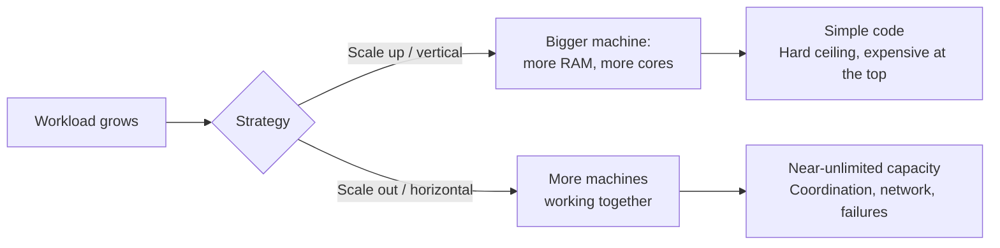
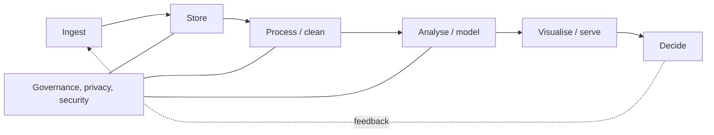

# 1. What is big data?

!!! abstract "Learning objectives"
    After this chapter you can:

    - define big data operationally, rather than by a fixed size threshold;
    - describe the 5 Vs and give an African example of each;
    - estimate the memory and time cost of a dataset before you load it;
    - explain why we scale **out** (more machines) instead of only scaling **up** (a bigger machine);
    - place the tools of this course on a map of data size versus complexity.

## 1.1 A working definition

There is no magic number of gigabytes at which data becomes "big". A useful, operational definition is:

> **Data is "big" when the way you have been processing it stops working** — it no longer fits in memory, takes too long, arrives too fast, or is too varied for your current tools — and you must change your *architecture*, not just your code.

For a pandas user on an 8 GB laptop, a 5 GB CSV is big data. For a bank, it may be 50 TB of transactions. The principles are the same; the course teaches you to recognise the moment you cross the line and to choose the right next tool.

## 1.2 The 5 Vs

| V | Meaning | African / Rwandan example |
|---|---|---|
| **Volume** | Amount of data | Sentinel-2 satellite imagery of Africa: petabytes, updated every 5 days |
| **Velocity** | Speed of arrival and required response time | Mobile money transactions: MTN MoMo and Airtel Money process millions per day; fraud must be flagged in milliseconds |
| **Variety** | Diversity of structure | A health ministry combining DHIS2 tables, scanned forms, SMS reports and GPS of clinics |
| **Veracity** | Quality and trustworthiness | Crowd-sourced OpenStreetMap roads; sensor readings with gaps during power cuts |
| **Value** | Usefulness for decisions | Rainfall forecasts that change when farmers plant beans in Rwanda's Season A |

Some authors add **Variability** (meaning changes over time — e.g., the word "airtime" in text) and **Visualisation**. Do not memorise lists; ask instead which V is making *your* problem hard, because each V calls for a different solution:

- Volume → distributed storage and computation (Chapters 3–7).
- Velocity → stream processing (Chapter 9).
- Variety → schema-on-read, data lakes, flexible formats (Chapter 3).
- Veracity → validation, data quality pipelines (Chapter 12).
- Value → good questions, sound statistics, ethics (Chapters 8 and 13).

## 1.3 Back-of-the-envelope estimation

Good data engineers estimate before they compute. Memorise these orders of magnitude:

| Unit | Bytes | Intuition |
|---|---|---|
| 1 KB | \(10^3\) | A short text message record |
| 1 MB | \(10^6\) | A photo |
| 1 GB | \(10^9\) | One month of NYC yellow-taxi trips as Parquet is ~50 MB; as CSV ~500 MB |
| 1 TB | \(10^{12}\) | A large laptop disk |
| 1 PB | \(10^{15}\) | Large satellite archives |

And these approximate latencies (the "numbers every programmer should know", rounded):

| Operation | Time |
|---|---|
| Read from L1 CPU cache | ~1 ns |
| Read from RAM | ~100 ns |
| Read 1 MB sequentially from RAM | ~10 µs |
| Read 1 MB sequentially from SSD | ~200 µs–1 ms |
| Read 1 MB sequentially from spinning disk | ~5 ms |
| Network round trip within a datacentre | ~0.5 ms |
| Network round trip Kigali ↔ Europe | ~100–150 ms |

**Lesson:** RAM is roughly 10–100× faster than disk, and disk is far faster than the wide-area network. Big data systems are designed around **moving computation to the data**, not data to the computation.

### Worked example: will it fit?

A national survey has 12 million rows and 40 columns: 30 float64 columns, 10 string columns averaging 15 characters.

\[
\text{floats: } 12\times10^6 \times 30 \times 8 \text{ B} = 2.88 \text{ GB}
\]

pandas stores Python strings with ~50 bytes of object overhead each, so

\[
\text{strings: } 12\times10^6 \times 10 \times (50 + 15) \text{ B} \approx 7.8 \text{ GB}
\]

Total ≈ 10.7 GB **before** any copies made during operations (a `merge` or `groupby` can easily double peak memory). On an 8 GB laptop this fails. Chapter 2 shows how to cut it to ~2 GB with better dtypes; Chapter 5 shows how to avoid loading it at all.

```python
def estimate_gb(rows, n_float=0, n_int=0, n_str=0, avg_str_len=10, str_overhead=50):
    """Rough in-memory size of a pandas DataFrame in GB."""
    b = rows * (n_float * 8 + n_int * 8 + n_str * (str_overhead + avg_str_len))
    return b / 1e9

print(f"{estimate_gb(12_000_000, n_float=30, n_str=10, avg_str_len=15):.1f} GB")
```

## 1.4 Scaling up versus scaling out



**Scaling up** is underrated: a single modern server with 1 TB of RAM and 128 cores handles a surprising amount of "big" data, and tools like Polars and DuckDB (Chapter 5) exploit it brilliantly. **Scaling out** becomes necessary when data exceeds what one machine can store or process in acceptable time, or when you need fault tolerance.

### Amdahl's law — the limit of parallelism

If a fraction \(p\) of a job can be parallelised and the rest \((1-p)\) is serial, the maximum speed-up on \(N\) workers is

\[
S(N) = \frac{1}{(1-p) + \dfrac{p}{N}}, \qquad \lim_{N\to\infty} S(N) = \frac{1}{1-p}.
\]

With \(p = 0.95\), even infinitely many machines give at most a 20× speed-up. In big data jobs the serial parts are things like reading a single gzip file, a final sort on one machine, or collecting results to the driver.

```python
import numpy as np
import matplotlib.pyplot as plt

N = np.arange(1, 257)
for p in (0.5, 0.9, 0.95, 0.99):
    plt.plot(N, 1 / ((1 - p) + p / N), label=f"p = {p}")
plt.xscale("log", base=2); plt.xlabel("workers N"); plt.ylabel("speed-up")
plt.legend(); plt.title("Amdahl's law"); plt.show()
```

**Gustafson's law** offers the optimistic counterpoint: in practice we use more machines to process *more data* in the same time, and the parallel fraction grows with the problem size.

## 1.5 The big data landscape and this course

| Data size (on disk) | Typical tool | Chapter |
|---|---|---|
| < 1 GB | pandas, NumPy | 2 |
| 1–100 GB | Polars, DuckDB, pandas with chunking, Dask on one machine | 2, 5 |
| 100 GB – 10 TB | Spark or Dask on a cluster; cloud warehouses (BigQuery, Snowflake) | 6–8 |
| > 10 TB, or continuous streams | Spark / Flink clusters, Kafka, lakehouse tables | 3, 9, 12 |

A brief history helps students see why tools look the way they do:

- **2003–2004** Google publishes the *Google File System* and *MapReduce* papers.
- **2006** Hadoop (HDFS + MapReduce) brings these ideas to open source.
- **2010–2014** Spark (UC Berkeley AMPLab) keeps data in memory between steps; becomes an Apache top-level project.
- **2016+** Apache Arrow standardises in-memory columnar data across languages.
- **2019+** Lakehouse table formats (Delta Lake, Apache Iceberg, Apache Hudi) bring database guarantees to files in object storage.
- **2020s** Fast single-node engines (DuckDB, Polars) shrink the set of problems that truly need a cluster; Spark 4 adds Spark Connect for thin clients.

## 1.6 The big data lifecycle



Each stage has its own tools, and every stage is governed by ethics and law (Chapter 13).

## Lab 1 — Estimating before computing

1. Run the environment check in [Setup](../setup.md).
2. Download one month of NYC yellow taxi data (Parquet):
   ```python
   import pandas as pd, os, urllib.request
   url = "https://d37ci6vzurychx.cloudfront.net/trip-data/yellow_tripdata_2024-01.parquet"
   os.makedirs("data", exist_ok=True)
   urllib.request.urlretrieve(url, "data/yellow_2024_01.parquet")
   df = pd.read_parquet("data/yellow_2024_01.parquet")
   print(df.shape)
   print(df.memory_usage(deep=True).sum() / 1e9, "GB in memory")
   print(os.path.getsize("data/yellow_2024_01.parquet") / 1e9, "GB on disk")
   ```
3. Explain the ratio between in-memory and on-disk size.
4. Estimate the memory needed for **all** of 2024 (12 months). Would it fit on your machine? On a 64 GB server?
5. Using Amdahl's law, if reading files is 20% of your job and cannot be parallelised, what is the best speed-up on 16 cores?

## Check yourself

1. Give an example where data is small in volume but still "big" because of velocity.
2. Why might a 30 GB dataset be easier to process on one large machine than on a cluster of ten small ones?
3. A job is 99% parallelisable. What is the speed-up on 100 workers? On 1000?

??? success "Answer to 3"
    \(S(100) = 1/(0.01 + 0.0099) \approx 50.3\); \(S(1000) = 1/(0.01 + 0.00099) \approx 91\). The ceiling is 100.

## Further reading

- Dean, J. & Ghemawat, S. (2004). *MapReduce: Simplified Data Processing on Large Clusters*. OSDI.
- Kleppmann, *Designing Data-Intensive Applications*, Chapter 1.
- McSherry, F., Isard, M. & Murray, D. (2015). *Scalability! But at what COST?* HotOS — a classic warning against using a cluster when one laptop thread would do.
