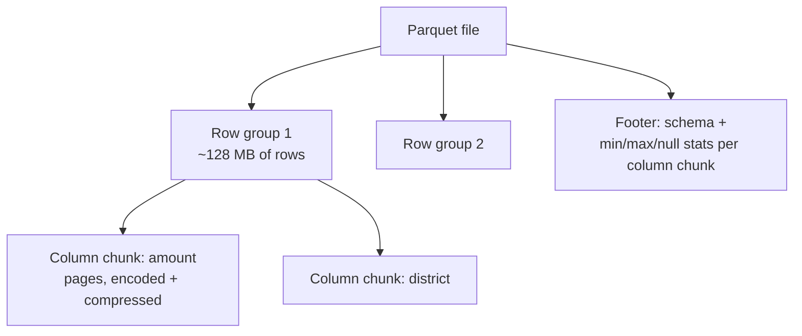

# 3. Storage, file formats & data lakes

!!! abstract "Learning objectives"
    - Compare row-oriented and column-oriented storage and know when each wins.
    - Explain how Parquet achieves small files and fast queries (encoding, compression, row groups, statistics).
    - Use Apache Arrow as a zero-copy bridge between tools.
    - Design a partitioned dataset and avoid the "small files problem".
    - Distinguish data warehouses, data lakes and lakehouses; know what Delta Lake and Iceberg add.
    - Recognise the main families of NoSQL databases.

## 3.1 Row versus column storage

Consider a table of mobile money transactions:

| id | sender | receiver | amount | district | ts |
|---|---|---|---|---|---|

**Row-oriented** (CSV, JSON lines, Avro, PostgreSQL pages) stores whole records together:
`1,A,B,5000,Gasabo,... | 2,C,D,1200,Huye,... | ...`

**Column-oriented** (Parquet, ORC, Arrow, DuckDB, data warehouses) stores each column together:
`1,2,3,... | A,C,... | B,D,... | 5000,1200,... | Gasabo,Huye,...`

| Workload | Winner | Why |
|---|---|---|
| Insert/update one transaction (OLTP) | Row | Write one contiguous record |
| `SELECT district, SUM(amount) GROUP BY district` over 1 billion rows (OLAP) | Column | Read 2 of 6 columns; similar values compress well; vectorised CPU loops |

Analytics is overwhelmingly OLAP, so big data storage is overwhelmingly columnar.

## 3.2 Comparing file formats

| Format | Layout | Schema | Compression | Splittable | Typical use |
|---|---|---|---|---|---|
| CSV | Row, text | None (inferred) | Poor (gzip makes it non-splittable) | Yes if uncompressed | Exchange, small data |
| JSON / JSON Lines | Row, text | Self-describing, nested | Poor | JSONL yes | APIs, logs |
| Avro | Row, binary | Embedded, evolvable | Good | Yes | Kafka messages, write-heavy pipelines |
| Parquet | Column, binary | Embedded, nested | Excellent | Yes (row groups) | Analytics — the default choice |
| ORC | Column, binary | Embedded | Excellent | Yes | Hive ecosystems |
| Arrow IPC / Feather | Column, binary, in-memory layout | Embedded | Optional (LZ4/ZSTD) | Yes | Fast interchange between processes |

"Splittable" matters: a 10 GB file that can be split lets 80 workers read it in parallel; a single `.csv.gz` must be decompressed by one worker from start to end (Amdahl's serial part!).

## 3.3 Inside Parquet



Four ideas make Parquet fast and small:

1. **Encoding.** *Dictionary encoding* replaces repeated strings ("Gasabo", "Gasabo", "Huye") by small integers plus a dictionary. *Run-length encoding* stores "Gasabo × 5000". *Delta encoding* stores differences of sorted timestamps.
2. **Compression** on top (Snappy — fast; ZSTD — smaller; GZIP — legacy).
3. **Column pruning (projection pushdown).** Read only the requested columns.
4. **Predicate pushdown with statistics.** Each column chunk stores min/max. A query `WHERE ts >= '2024-06-01'` skips row groups whose max timestamp is earlier — without reading them. Sorting data by commonly filtered columns makes this dramatically more effective.

```python
import pyarrow.parquet as pq

pf = pq.ParquetFile("data/yellow_2024_01.parquet")
print(pf.schema_arrow)
print(pf.metadata)                       # rows, row groups, created_by
rg = pf.metadata.row_group(0)
col = rg.column(rg.num_columns - 1)
print(col.path_in_schema, col.compression, col.statistics)
```

### Benchmark: CSV versus Parquet

```python
import pandas as pd, time, os

df = pd.read_parquet("data/yellow_2024_01.parquet")
df.to_csv("data/trips.csv", index=False)
for codec in ("snappy", "zstd", "gzip"):
    df.to_parquet(f"data/trips_{codec}.parquet", compression=codec)

for f in ["data/trips.csv", "data/trips_snappy.parquet",
          "data/trips_zstd.parquet", "data/trips_gzip.parquet"]:
    t0 = time.perf_counter()
    if f.endswith(".csv"):
        pd.read_csv(f, usecols=["PULocationID", "fare_amount"])
    else:
        pd.read_parquet(f, columns=["PULocationID", "fare_amount"])
    print(f"{f:32s} {os.path.getsize(f)/1e6:8.1f} MB  {time.perf_counter()-t0:6.2f} s")
```

Typical result: Parquet is 5–10× smaller and 10–50× faster to read two columns.

## 3.4 Apache Arrow: the common language

Before Arrow, moving data from pandas to Spark meant serialising every value. **Apache Arrow** defines a standard *in-memory* columnar format. Tools that speak Arrow (pandas, Polars, DuckDB, Spark, R, Julia) can share data with little or no copying.

```python
import pyarrow as pa, pyarrow.compute as pc, polars as pl, duckdb

table = pq.read_table("data/yellow_2024_01.parquet", columns=["PULocationID", "fare_amount"])
print(pc.mean(table["fare_amount"]))

pl_df = pl.from_arrow(table)                                  # zero-copy where possible
print(duckdb.sql("SELECT PULocationID, avg(fare_amount) FROM table GROUP BY 1 LIMIT 5"))
```

DuckDB can query the local Python variable `table` directly — that is Arrow at work. In Spark, setting `spark.sql.execution.arrow.pyspark.enabled=true` speeds up `toPandas()` and pandas UDFs.

## 3.5 Partitioning datasets

A **partitioned dataset** is a directory tree where folder names encode column values (Hive-style):

```text
trips/
├── year=2024/
│   ├── month=01/part-0.parquet
│   ├── month=02/part-0.parquet
│   └── ...
└── year=2025/...
```

A query filtering `year=2024 AND month=02` reads one folder — **partition pruning**.

```python
import pyarrow.dataset as ds

df["year"] = df.tpep_pickup_datetime.dt.year
df["month"] = df.tpep_pickup_datetime.dt.month
pq.write_to_dataset(pa.Table.from_pandas(df), root_path="data/trips_part",
                    partition_cols=["year", "month"])

dataset = ds.dataset("data/trips_part", format="parquet", partitioning="hive")
feb = dataset.to_table(filter=(ds.field("month") == 2), columns=["fare_amount"])
```

### Choosing partition columns

- Partition on columns that appear in **most filters** and have **low-to-moderate cardinality** (date, country, district).
- Never partition on high-cardinality columns (user ID, transaction ID): you create millions of tiny files.
- Target files of **~100 MB–1 GB**. Thousands of 1 KB files is the **small files problem**: listing and opening files dominates the runtime, and metadata overloads the storage system.

## 3.6 Where files live: from HDFS to object storage

| System | Description |
|---|---|
| Local disk | Fine for one machine |
| HDFS | Hadoop Distributed File System: files split into 128 MB blocks, each replicated 3× across machines; compute moves to the blocks |
| Object storage (Amazon S3, Google Cloud Storage, Azure Blob, MinIO) | Today's default: cheap, practically unlimited, accessed over HTTP; compute and storage are separated |

Most Python tools read object storage directly, e.g. `pd.read_parquet("s3://bucket/path/")`, `duckdb.sql("SELECT * FROM 's3://...'")`, `spark.read.parquet("s3a://...")`. Many public datasets in this course live in AWS S3 buckets with free access (see [Data sources](../resources/data-sources.md)).

## 3.7 Warehouses, lakes and lakehouses

| | Data warehouse | Data lake | Lakehouse |
|---|---|---|---|
| Storage | Proprietary, inside the database | Files (Parquet, JSON, images) in object storage | Files in object storage **plus** a transaction log |
| Schema | Schema-on-write (strict) | Schema-on-read (flexible) | Enforced, evolvable |
| Updates / deletes | Yes, ACID | Painful (rewrite files) | Yes, ACID |
| Data types | Structured | Anything | Anything |
| Examples | BigQuery, Snowflake, Redshift | S3 + Parquet | Delta Lake, Apache Iceberg, Apache Hudi |

A plain data lake has problems: two jobs writing at once corrupt a table; deleting one person's records (a legal right under data protection law!) means rewriting files; there is no history. **Table formats** solve these by adding a metadata/transaction log next to the Parquet files, giving:

- ACID transactions (atomic commits; readers never see half-written data);
- `UPDATE`, `DELETE`, `MERGE` (upsert);
- **time travel** (query the table as of yesterday);
- schema evolution and enforcement.

```python
# Delta Lake without Spark, via the deltalake (delta-rs) package
# pip install deltalake
from deltalake import write_deltalake, DeltaTable

write_deltalake("data/trips_delta", df[["PULocationID", "fare_amount"]].head(1000))
write_deltalake("data/trips_delta", df[["PULocationID", "fare_amount"]].iloc[1000:2000], mode="append")

dt = DeltaTable("data/trips_delta")
print(dt.version(), len(dt.to_pandas()))
print(len(DeltaTable("data/trips_delta", version=0).to_pandas()))   # time travel: 1000 rows
```

## 3.8 NoSQL in one page

Not all big data is tabular files. NoSQL ("not only SQL") databases trade some relational features for scale or flexibility:

| Family | Data model | Strengths | Examples |
|---|---|---|---|
| Key-value | `key → blob` | Extreme speed, caching, sessions | Redis, DynamoDB |
| Document | JSON-like documents | Flexible schema, nested data | MongoDB, Couchbase |
| Wide-column | Rows with dynamic columns, partitioned by key | Huge write throughput, time series | Cassandra, HBase, ScyllaDB |
| Graph | Nodes and edges | Relationship queries | Neo4j, JanusGraph |
| Search | Inverted index | Full-text search, logs | Elasticsearch, OpenSearch |

The **CAP theorem** (Chapter 4) explains the consistency trade-offs these systems make.

## Lab 3 — Formats in practice

1. Run the CSV vs Parquet benchmark above. Add Feather (`df.to_feather`). Tabulate size, write time, full-read time, two-column read time.
2. Create a dataset partitioned by `year/month` for three months. Time a query for one month versus scanning everything.
3. Sort one month by `tpep_pickup_datetime`, write with `row_group_size=100_000`, and inspect the min/max statistics per row group. Query one day with `pyarrow.dataset` and count how many row groups were needed.
4. Deliberately create the small files problem: write the same month partitioned by `PULocationID` **and** `DOLocationID`. Count files and time a full scan. Explain.

## Check yourself

1. Why does dictionary encoding work well for `payment_type` but poorly for `trip_id`?
2. Your colleague stores 5 years of data as one 400 GB `.csv.gz`. List three problems.
3. What does a lakehouse table format add to "Parquet files in S3"?

## Further reading

- Apache Parquet documentation: [parquet.apache.org/docs](https://parquet.apache.org/docs/)
- Apache Arrow: [arrow.apache.org](https://arrow.apache.org/)
- Armbrust et al. (2021). *Lakehouse: A New Generation of Open Platforms that Unify Data Warehousing and Advanced Analytics*. CIDR.
