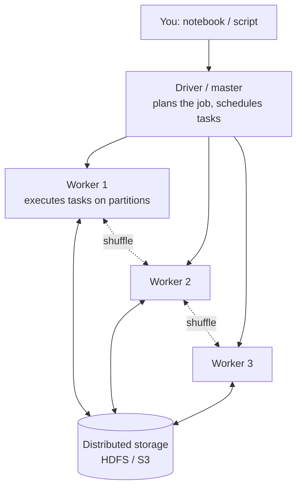
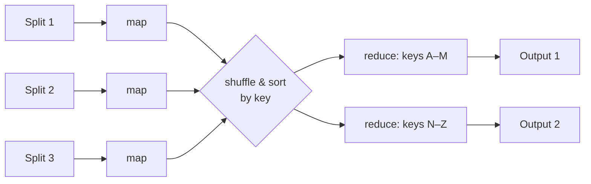

# 4. Distributed computing & MapReduce

!!! abstract "Learning objectives"
    - Describe the architecture of a cluster: driver/master, workers, storage, network.
    - Explain data parallelism, partitioning, and the cost of a shuffle.
    - Express computations in the MapReduce model and implement a MapReduce engine in Python.
    - Explain fault tolerance through replication and recomputation.
    - State the CAP theorem and apply it to real systems.

## 4.1 Why distributed computing is hard

The "fallacies of distributed computing" (Peter Deutsch and colleagues at Sun) are assumptions that newcomers make and that are false:

1. The network is reliable.
2. Latency is zero.
3. Bandwidth is infinite.
4. The network is secure.
5. Topology doesn't change.
6. There is one administrator.
7. Transport cost is zero.
8. The network is homogeneous.

With 1,000 machines each failing on average once every three years, you expect roughly one failure **per day**. Big data frameworks exist so that you, the analyst, do not have to handle these issues by hand.

## 4.2 Anatomy of a cluster



- Data is split into **partitions** (chunks), e.g. HDFS blocks or Parquet row groups.
- A **task** is one unit of work on one partition. With 1,000 partitions and 100 cores, tasks run in ~10 waves.
- **Data locality**: the scheduler prefers to run a task on the machine that already holds its partition.

## 4.3 Narrow versus wide operations

| Narrow (no data movement) | Wide (requires a shuffle) |
|---|---|
| `map`, `filter`, select columns, add a column | `groupBy` + aggregate, `join`, `distinct`, `orderBy`, `repartition` |
| Each output partition depends on one input partition | Each output partition needs data from **many** input partitions |

A **shuffle** redistributes records across the network so that all records with the same key land on the same machine. It involves serialising data, writing to local disk, network transfer, and reading back. **Shuffles are the main cost of distributed jobs**; much of performance tuning (Chapter 7) is about avoiding or shrinking them.

## 4.4 The MapReduce model

MapReduce expresses a computation as two user functions:

\[
\text{map}: (k_1, v_1) \rightarrow \text{list}(k_2, v_2) \qquad
\text{reduce}: (k_2, \text{list}(v_2)) \rightarrow \text{list}(v_3)
\]

The framework does everything else: split input, run maps in parallel, **shuffle and sort** by \(k_2\), run reduces in parallel, handle failures.



### Word count, the "hello world" of big data

```text
map("doc1", "umuganda is community work")  → (umuganda,1) (is,1) (community,1) (work,1)
map("doc2", "community work on saturday")   → (community,1) (work,1) (on,1) (saturday,1)
shuffle → community:[1,1]  work:[1,1]  umuganda:[1] ...
reduce("community", [1,1]) → (community, 2)
```

A **combiner** is a mini-reduce run on each mapper's output before the shuffle, turning `(work,1),(work,1),(work,1)` into `(work,3)` locally. It is valid when the reduce function is associative and commutative (sum, max — but not mean, unless you carry (sum, count) as in Chapter 2).

### Build your own MapReduce engine

This is the core lab of the chapter. It runs on one machine using processes, but has exactly the structure of Hadoop.

```python title="minimr.py"
from collections import defaultdict
from concurrent.futures import ProcessPoolExecutor
from itertools import chain
import hashlib

def _partition(key, n_reducers):
    """Deterministic hash partitioner (Python's hash() is randomised per process)."""
    return int(hashlib.md5(str(key).encode()).hexdigest(), 16) % n_reducers

def _map_task(args):
    mapper, combiner, chunk, n_reducers = args
    buckets = [defaultdict(list) for _ in range(n_reducers)]
    for record in chunk:
        for k, v in mapper(record):
            buckets[_partition(k, n_reducers)][k].append(v)
    if combiner:                                   # local pre-aggregation
        buckets = [{k: [combiner(k, vs)] for k, vs in b.items()} for b in buckets]
    return buckets

def _reduce_task(args):
    reducer, groups = args
    return [(k, reducer(k, vs)) for k, vs in sorted(groups.items())]

def map_reduce(records, mapper, reducer, combiner=None, n_mappers=4, n_reducers=2):
    records = list(records)
    size = max(1, len(records) // n_mappers + 1)
    chunks = [records[i:i + size] for i in range(0, len(records), size)]
    with ProcessPoolExecutor(n_mappers) as ex:
        map_out = list(ex.map(_map_task, [(mapper, combiner, c, n_reducers) for c in chunks]))
        # shuffle: gather bucket r from every mapper
        shuffled = []
        for r in range(n_reducers):
            merged = defaultdict(list)
            for buckets in map_out:
                for k, vs in buckets[r].items():
                    merged[k].extend(vs)
            shuffled.append(merged)
        red_out = list(ex.map(_reduce_task, [(reducer, g) for g in shuffled]))
    return list(chain.from_iterable(red_out))
```

```python title="wordcount.py"
import re
from minimr import map_reduce

def mapper(line):
    for w in re.findall(r"[a-zà-ÿ']+", line.lower()):
        yield w, 1

def reducer(word, counts):
    return sum(counts)

if __name__ == "__main__":
    lines = open("corpus.txt", encoding="utf-8")
    result = map_reduce(lines, mapper, reducer, combiner=reducer)
    for w, c in sorted(result, key=lambda x: -x[1])[:20]:
        print(w, c)
```

### Thinking in MapReduce: more patterns

| Problem | Map emits | Reduce computes |
|---|---|---|
| Mean fare per zone | `(zone, (fare, 1))` | `(Σfare / Σcount)` |
| Inverted index (search engine) | `(word, doc_id)` | sorted list of doc_ids |
| Max temperature per station per year | `((station, year), temp)` | `max` |
| Reduce-side join of trips and zones | `(zone_id, ("T", trip))`, `(zone_id, ("Z", name))` | pair each trip with the zone name |
| Matrix–vector product \(y = Ax\) | for \(a_{ij}\): `(i, a_ij * x_j)` | `y_i = Σ` |

## 4.5 Fault tolerance

Two strategies:

1. **Replication of data.** HDFS stores each block on 3 machines. Losing a disk loses nothing.
2. **Re-execution of tasks.** Map and reduce functions are deterministic and side-effect free, so a failed task is simply re-run elsewhere. Hadoop writes intermediate results to disk for this reason — making it robust but slow for iterative algorithms.

**Spark's insight (Chapter 6):** instead of writing every intermediate result to disk, remember the *lineage* — the recipe of transformations that produced each partition — and recompute lost partitions on demand. Keep data in memory between steps. This makes iterative machine learning 10–100× faster than Hadoop MapReduce.

**Stragglers:** one slow machine delays the whole stage. Frameworks launch *speculative* backup copies of slow tasks and take whichever finishes first.

## 4.6 The CAP theorem

In a distributed data store, when a **network partition** (P) occurs — some machines cannot talk to others — you must choose between:

- **Consistency (C):** every read sees the most recent write;
- **Availability (A):** every request receives a (non-error) response.

You cannot have both during a partition. Partitions *will* happen, so the real choice is C or A when they do.

| System behaviour during a partition | Choice | Examples |
|---|---|---|
| Refuse writes/reads that might be stale | CP | HBase, MongoDB (default majority settings), ZooKeeper, banking ledgers |
| Keep answering, reconcile later | AP | Cassandra, DynamoDB (default), DNS |

**Example — mobile money.** A balance must never be double-spent: choose consistency for the ledger. A "recent transactions" display can tolerate being seconds stale: choose availability.

The **PACELC** extension adds: *Else* (no partition), trade **Latency** against **Consistency**.

## 4.7 Hadoop today

Hadoop MapReduce is rarely used for new projects, but its ideas — HDFS, partitioning, shuffle, YARN resource management — live on inside Spark, Dask, Flink and cloud services. Understanding MapReduce makes every later tool easier to reason about.

## Lab 4 — Your own MapReduce

1. Download a large text corpus. Suggestions: the Kinyarwanda Wikipedia dump (`rwwiki`) from [dumps.wikimedia.org](https://dumps.wikimedia.org/rwwiki/), or an English Wikipedia sample, or Project Gutenberg books.
2. Run `wordcount.py` with and without the combiner. Measure the number of `(key, value)` pairs shuffled in each case.
3. Write a mapper/reducer computing the **mean and standard deviation of trip distance per pickup zone** from a taxi CSV, using a combiner that is mathematically correct.
4. Implement a **reduce-side join** between trips and the taxi zone lookup table (`taxi_zone_lookup.csv` from the NYC TLC website).
5. Vary `n_mappers` from 1 to 8 and plot run time. Where does the speed-up stop, and why?

## Check yourself

1. Why must the combiner be associative and commutative?
2. Which of these needs a shuffle: (a) convert fares to RWF, (b) count trips per day, (c) remove trips with zero distance, (d) sort by fare?
3. A Rwandan telecom's subscriber database must keep serving calls even if the link between Kigali and Rubavu datacentres fails. Which CAP choice? What risk does that create?

## Further reading

- Dean & Ghemawat (2004), *MapReduce*. Ghemawat, Gobioff & Leung (2003), *The Google File System*.
- Leskovec, Rajaraman & Ullman, *Mining of Massive Datasets*, Chapter 2 (free at mmds.org).
- Brewer, E. (2012). *CAP Twelve Years Later: How the "Rules" Have Changed*. IEEE Computer.
