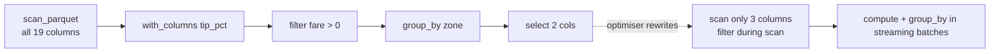

# 5. Polars, DuckDB & Dask

!!! abstract "Learning objectives"
    - Explain **lazy evaluation** and **query optimisation** and why they matter for big data.
    - Write the same analysis in Polars, DuckDB (SQL) and Dask.
    - Process datasets larger than RAM on a single machine with streaming execution.
    - Choose between these tools and Spark for a given problem.

Modern single-node engines handle tens to hundreds of gigabytes on a laptop. Before you rent a cluster, try these.

## 5.1 Eager versus lazy evaluation

**Eager** (pandas): every line runs immediately and materialises a full intermediate result.

**Lazy** (Polars LazyFrame, Dask, Spark, DuckDB SQL): each line adds a step to a **query plan**; nothing runs until you ask for a result. The engine can then optimise the whole plan:

- **Projection pushdown** — read only needed columns.
- **Predicate pushdown** — apply filters while reading (using Parquet statistics).
- **Operator fusion** — combine steps into one pass over the data.
- **Streaming** — process the data in batches, never holding it all in memory.



## 5.2 Polars

Polars is a DataFrame library written in Rust, built on Arrow, multi-threaded by default, with an expressive expression API.

### Eager basics

```python
import polars as pl

df = pl.read_parquet("data/yellow_2024_01.parquet")
print(df.schema)

out = (
    df.filter(pl.col("fare_amount") > 0)
      .with_columns((100 * pl.col("tip_amount") / pl.col("fare_amount")).alias("tip_pct"))
      .group_by("PULocationID")
      .agg(pl.len().alias("trips"),
           pl.col("tip_pct").mean().alias("mean_tip_pct"),
           pl.col("trip_distance").median().alias("median_km"))
      .sort("trips", descending=True)
)
print(out.head())
```

### Expressions are the key idea

`pl.col("fare_amount") > 0` is not computed immediately; it is an **expression** that Polars can optimise and run in parallel across columns.

```python
df.select(
    pl.col("tpep_pickup_datetime").dt.hour().alias("hour"),
    pl.col("^.*_amount$").sum(),                       # regex: all amount columns
    pl.when(pl.col("trip_distance") > 10).then(pl.lit("long"))
      .otherwise(pl.lit("short")).alias("trip_type"),
)
```

### Lazy and streaming: larger than memory

```python
lazy = (
    pl.scan_parquet("data/yellow_2024_*.parquet")      # glob over many files, nothing read yet
      .filter(pl.col("fare_amount") > 0)
      .group_by(pl.col("tpep_pickup_datetime").dt.month().alias("month"))
      .agg(pl.len(), pl.col("total_amount").sum())
      .sort("month")
)
print(lazy.explain())                 # inspect the optimised plan
result = lazy.collect(engine="streaming")   # batch-wise execution, low memory
```

Look for `PROJECT 3/19 COLUMNS` and `SELECTION` inside the scan in the plan: proof of pushdown.

### Window functions and joins

```python
zones = pl.read_csv("https://d37ci6vzurychx.cloudfront.net/misc/taxi_zone_lookup.csv")

ranked = (
    df.lazy()
      .join(zones.lazy(), left_on="PULocationID", right_on="LocationID")
      .group_by(["Borough", "Zone"]).agg(pl.len().alias("trips"))
      .with_columns(pl.col("trips").rank(descending=True).over("Borough").alias("rank_in_borough"))
      .filter(pl.col("rank_in_borough") <= 3)
      .collect()
)
```

## 5.3 DuckDB

DuckDB is an in-process analytical SQL database — "SQLite for analytics". There is no server; it runs inside Python, queries Parquet/CSV/JSON files directly (including over HTTP and S3), spills to disk when memory runs out, and uses all cores.

```python
import duckdb

con = duckdb.connect()            # in-memory; use duckdb.connect("lab.duckdb") to persist

con.sql("""
    SELECT PULocationID,
           count(*)                          AS trips,
           avg(tip_amount / fare_amount)*100 AS mean_tip_pct,
           quantile_cont(trip_distance, 0.5) AS median_km
    FROM 'data/yellow_2024_*.parquet'
    WHERE fare_amount > 0
    GROUP BY 1
    ORDER BY trips DESC
    LIMIT 10
""").show()
```

### Query remote files without downloading

```python
con.sql("INSTALL httpfs; LOAD httpfs;")
con.sql("""
    SELECT count(*), avg(trip_distance)
    FROM 'https://d37ci6vzurychx.cloudfront.net/trip-data/yellow_tripdata_2024-03.parquet'
""").show()
```

Because of Parquet footers and HTTP range requests, DuckDB fetches only the bytes it needs.

### Mix SQL and DataFrames

```python
import pandas as pd
zones = pd.read_csv("https://d37ci6vzurychx.cloudfront.net/misc/taxi_zone_lookup.csv")

top = con.sql("""
    SELECT z.Borough, count(*) AS trips
    FROM 'data/yellow_2024_01.parquet' t
    JOIN zones z ON t.PULocationID = z.LocationID
    GROUP BY 1 ORDER BY 2 DESC
""").pl()          # .df() for pandas, .arrow() for Arrow, .pl() for Polars
```

### Useful features

```sql
EXPLAIN ANALYZE SELECT ...;                          -- plan with timings
COPY (SELECT * FROM 'raw/*.csv') TO 'clean' (FORMAT parquet, PARTITION_BY (year, month));
SUMMARIZE SELECT * FROM 'data/yellow_2024_01.parquet';   -- instant data profile
SET memory_limit = '4GB'; SET threads = 4;
```

## 5.4 Dask

Dask parallelises the familiar pandas and NumPy APIs by splitting data into many smaller pandas DataFrames (partitions) and building a **task graph**. It scales from a laptop to a cluster with the same code.

```python
import dask.dataframe as dd
from dask.distributed import Client

client = Client()            # local cluster: one worker per core; dashboard link printed
print(client.dashboard_link)

ddf = dd.read_parquet("data/yellow_2024_*.parquet",
                      columns=["PULocationID", "fare_amount", "tip_amount", "trip_distance"])
print(ddf.npartitions)

result = (ddf[ddf.fare_amount > 0]
          .assign(tip_pct=lambda d: 100 * d.tip_amount / d.fare_amount)
          .groupby("PULocationID")
          .agg({"tip_pct": "mean", "trip_distance": ["mean", "max"]}))

result.visualize("graph.png")   # optional: draw the task graph (needs graphviz)
pdf = result.compute()          # execute → pandas DataFrame
```

### Dask beyond DataFrames

```python
import dask.array as da
x = da.random.random((100_000, 10_000), chunks=(10_000, 10_000))   # 8 GB, never all in RAM
print((x - x.mean(axis=0)).std(axis=0)[:5].compute())

import dask
@dask.delayed
def process(path): ...
results = dask.compute(*[process(p) for p in paths])   # parallelise arbitrary Python
```

Dask arrays power **xarray** for climate and satellite data (Chapter 10), and Dask-ML for scalable scikit-learn (Chapter 8). Open the dashboard while jobs run: the task stream, progress bars and memory panels are excellent teaching tools.

## 5.5 Choosing a tool

| Situation | Recommended |
|---|---|
| Data fits comfortably in RAM, team knows pandas | pandas (with Arrow dtypes) |
| 1–200 GB on one machine, DataFrame style | **Polars** (lazy + streaming) |
| 1–200 GB on one machine, SQL style, ad-hoc exploration of files | **DuckDB** |
| Need the pandas/NumPy/scikit-learn API on multiple machines, or arbitrary Python task parallelism, or n-dimensional arrays | **Dask** |
| Multi-terabyte data, shared clusters, streaming, mature ecosystem, JVM integration | **Spark** (Chapters 6–9) |

These tools interoperate through Arrow, so you can mix them in one notebook.

## Lab 5 — Three engines, one question

Using 3–12 months of NYC yellow taxi data (choose a size that is larger than comfortable for pandas on your machine):

**Question:** for each hour of the day and day of the week, what is the median trip speed (km/h) in Manhattan? (Distance is in miles: multiply by 1.609.)

1. Answer it in pandas (if possible), Polars lazy, DuckDB SQL, and Dask.
2. Record wall-clock time and peak memory for each (use `/usr/bin/time -v python script.py` on Linux, or `memory_profiler`).
3. Print the Polars plan and DuckDB `EXPLAIN` output; identify the pushdowns.
4. Plot a heatmap (hour × weekday) of median speed.
5. Write a half-page recommendation: which engine would you choose for this team, and why?

## Check yourself

1. Why can a lazy engine use less memory than an eager one for the same query?
2. In Dask, what is a partition? What happens if you have 3 partitions and 16 cores?
3. When is DuckDB a better choice than Spark? When is it worse?

## Further reading

- Polars user guide: [docs.pola.rs](https://docs.pola.rs/)
- DuckDB documentation: [duckdb.org/docs](https://duckdb.org/docs/)
- Dask tutorial: [tutorial.dask.org](https://tutorial.dask.org/)
- Raasveldt & Mühleisen (2019). *DuckDB: an Embeddable Analytical Database*. SIGMOD.
