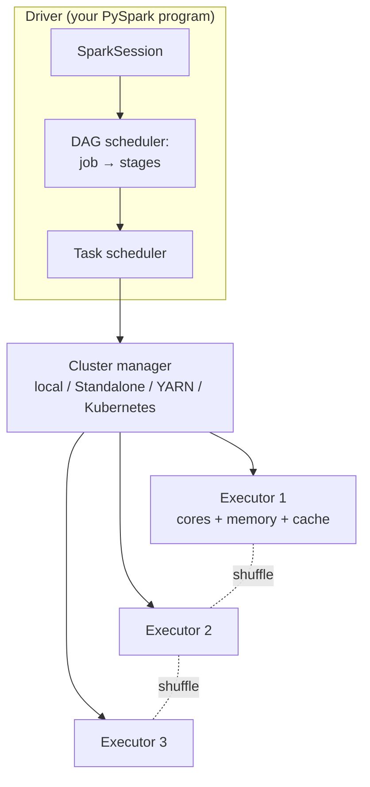

# 6. Apache Spark fundamentals

!!! abstract "Learning objectives"
    - Describe Spark's architecture: driver, executors, cluster manager, jobs, stages, tasks.
    - Explain RDDs, lineage and lazy evaluation.
    - Distinguish transformations from actions, and narrow from wide transformations.
    - Read, transform, aggregate and write data with the PySpark DataFrame API.
    - Use the Spark UI to understand what a job did.

## 6.1 What is Spark?

Apache Spark is a unified engine for large-scale data processing. One API covers batch SQL and DataFrames, machine learning (MLlib), streaming (Structured Streaming) and graph processing. Programs are written in Python (PySpark), Scala, Java, R or SQL. The current release line is **Spark 4.x**, which requires Java 17+ and Python 3.9+, enables ANSI SQL mode by default, and makes **Spark Connect** (a thin client–server protocol) a first-class way to connect.

## 6.2 Architecture



| Term | Meaning |
|---|---|
| **Driver** | Process running your `main` program; builds the plan and schedules work |
| **Executor** | JVM process on a worker that runs tasks and caches data |
| **Cluster manager** | Allocates executors: `local[*]` (all cores of your laptop), Standalone, YARN, Kubernetes |
| **Job** | Triggered by each **action** (e.g. `count()`, `write`) |
| **Stage** | A set of tasks that can run without a shuffle; jobs are split at shuffle boundaries |
| **Task** | Work on one partition, on one core |

In `local[*]` mode, the driver and executors run inside one process on your laptop — perfect for learning; the same code runs unchanged on a 500-node cluster.

## 6.3 Starting Spark

```python
from pyspark.sql import SparkSession, functions as F, types as T

spark = (SparkSession.builder
         .appName("aims-bda-lab6")
         .master("local[*]")
         .config("spark.driver.memory", "4g")
         .config("spark.sql.shuffle.partitions", "16")   # default 200 is too many for a laptop
         .getOrCreate())

print(spark.version)
print(spark.sparkContext.uiWebUrl)   # open the Spark UI, usually http://localhost:4040
```

!!! note "Databricks and Spark Connect"
    On Databricks, `spark` already exists. With Spark Connect you write `SparkSession.builder.remote("sc://host:15002").getOrCreate()`; the DataFrame API is the same, but the low-level RDD API is not available.

## 6.4 RDDs: the foundation

A **Resilient Distributed Dataset** is an immutable, partitioned collection of records, plus its **lineage** — the chain of transformations used to build it. If a partition is lost, Spark recomputes it from lineage.

```python
sc = spark.sparkContext
rdd = sc.parallelize(range(1, 1_000_001), numSlices=8)
print(rdd.getNumPartitions())

squares = rdd.map(lambda x: x * x)          # transformation (lazy)
evens = squares.filter(lambda x: x % 2 == 0)
print(evens.count())                         # action → runs the job
print(evens.toDebugString().decode())        # lineage
```

Word count, now in Spark — compare it with your MapReduce engine from Chapter 4:

```python
counts = (sc.textFile("data/corpus.txt")
            .flatMap(lambda line: line.lower().split())
            .map(lambda w: (w, 1))
            .reduceByKey(lambda a, b: a + b)       # combiner + shuffle + reduce
            .sortBy(lambda kv: -kv[1]))
print(counts.take(10))
```

`reduceByKey` combines locally before shuffling; `groupByKey` ships every value across the network. Prefer `reduceByKey`/`aggregateByKey`.

**Why we mostly use DataFrames instead:** RDD lambdas are opaque Python functions that Spark cannot optimise, and each record crosses the Python–JVM boundary. DataFrame operations are declarative, so Spark's **Catalyst optimiser** rewrites them and the **Tungsten** engine runs them as compiled JVM code with no Python overhead.

## 6.5 Transformations and actions

| Transformations (lazy, return a new DataFrame) | Actions (trigger execution) |
|---|---|
| `select`, `filter`/`where`, `withColumn`, `drop` | `count`, `show`, `collect`, `take`, `first` |
| `groupBy().agg()`, `join`, `union`, `distinct`, `orderBy` | `write...`, `toPandas`, `foreach` |

!!! danger "Beware of `collect()` and `toPandas()`"
    They bring the *entire* result to the driver's memory. On a billion-row DataFrame they crash the driver. Aggregate or `limit()` first.

## 6.6 The DataFrame API

### Reading data

```python
trips = spark.read.parquet("data/yellow_2024_*.parquet")
trips.printSchema()
print(trips.count(), len(trips.columns))

zones = (spark.read
         .option("header", True)
         .option("inferSchema", True)
         .csv("data/taxi_zone_lookup.csv"))
```

For CSV and JSON in production, **declare the schema** — inference requires an extra pass over the data and may guess wrong:

```python
schema = T.StructType([
    T.StructField("LocationID", T.IntegerType()),
    T.StructField("Borough", T.StringType()),
    T.StructField("Zone", T.StringType()),
    T.StructField("service_zone", T.StringType()),
])
zones = spark.read.csv("data/taxi_zone_lookup.csv", header=True, schema=schema)
```

### Selecting, filtering, deriving columns

```python
clean = (trips
    .filter((F.col("fare_amount") > 0) & (F.col("trip_distance").between(0.1, 100)))
    .withColumn("duration_min",
                (F.unix_timestamp("tpep_dropoff_datetime") -
                 F.unix_timestamp("tpep_pickup_datetime")) / 60)
    .filter(F.col("duration_min").between(1, 180))
    .withColumn("speed_kmh", F.col("trip_distance") * 1.609 / (F.col("duration_min") / 60))
    .withColumn("pickup_hour", F.hour("tpep_pickup_datetime"))
    .withColumn("pickup_dow", F.dayofweek("tpep_pickup_datetime"))
    .withColumn("is_airport", F.col("RatecodeID").isin(2, 3))
    .select("tpep_pickup_datetime", "PULocationID", "DOLocationID", "pickup_hour", "pickup_dow",
            "trip_distance", "duration_min", "speed_kmh", "fare_amount",
            "tip_amount", "payment_type", "is_airport"))
clean.show(5)
```

### Aggregation

```python
by_hour = (clean.groupBy("pickup_hour")
           .agg(F.count("*").alias("trips"),
                F.round(F.avg("speed_kmh"), 1).alias("avg_speed"),
                F.percentile_approx("fare_amount", 0.5).alias("median_fare"),
                F.sum("tip_amount").alias("total_tips"))
           .orderBy("pickup_hour"))
by_hour.show(24)
```

### Joins

```python
enriched = clean.join(zones.withColumnRenamed("LocationID", "PULocationID"),
                      on="PULocationID", how="left")
(enriched.groupBy("Borough").count().orderBy(F.desc("count")).show())
```

### Handling missing values and conditional logic

```python
trips.select([F.sum(F.col(c).isNull().cast("int")).alias(c) for c in trips.columns]).show(vertical=True)

trips = (trips
    .fillna({"passenger_count": 1})
    .withColumn("payment",
                F.when(F.col("payment_type") == 1, "card")
                 .when(F.col("payment_type") == 2, "cash")
                 .otherwise("other")))
```

### Writing results

```python
(by_hour.coalesce(1).write.mode("overwrite").option("header", True).csv("out/by_hour_csv"))
(enriched.write.mode("overwrite").partitionBy("Borough").parquet("out/trips_by_borough"))
```

Spark writes a **directory** of part files (one per partition), plus a `_SUCCESS` marker — not a single file. `coalesce(1)` forces one file; use it only for small outputs.

### Spark SQL

Every DataFrame can be queried with SQL; both compile to the same plan.

```python
clean.createOrReplaceTempView("trips")
spark.sql("""
    SELECT pickup_dow, pickup_hour, percentile_approx(speed_kmh, 0.5) AS median_speed
    FROM trips
    GROUP BY pickup_dow, pickup_hour
    ORDER BY pickup_dow, pickup_hour
""").show()
```

## 6.7 Lazy evaluation and the DAG in practice

```python
q = clean.groupBy("PULocationID").agg(F.avg("fare_amount").alias("avg_fare"))
q.explain(mode="formatted")
```

In the physical plan, look for:

- `FileScan parquet ... ReadSchema:` — only the needed columns (projection pushdown);
- `PushedFilters:` — filters applied at the source;
- `HashAggregate (partial)` → `Exchange hashpartitioning` → `HashAggregate (final)` — the combiner, the shuffle, and the reduce, exactly as in Chapter 4.

Now run `q.show()` and open the Spark UI (port 4040): **Jobs** → one job; **Stages** → two stages separated by the `Exchange`; each stage's task count equals its partition count; the **SQL / DataFrame** tab shows the same plan with row counts.

## 6.8 Partitions

```python
print(trips.rdd.getNumPartitions())          # set by file sizes (~128 MB per input split)
fewer = trips.coalesce(4)                    # merge partitions, no full shuffle
more = trips.repartition(64, "PULocationID") # full shuffle, hash by key
```

Rules of thumb: 2–4 tasks per core; partitions of roughly 100–200 MB; set `spark.sql.shuffle.partitions` to match data size (or rely on Adaptive Query Execution, Chapter 7).

## 6.9 Caching

If you reuse a DataFrame in several actions, cache it, or Spark recomputes it from the source each time.

```python
clean.cache()          # or .persist(StorageLevel.MEMORY_AND_DISK)
clean.count()          # first action materialises the cache
# ... many queries on clean ...
clean.unpersist()
```

Check the **Storage** tab of the Spark UI to see what is cached and how much memory it uses.

## 6.10 Python UDFs — and how to avoid them

A plain Python UDF sends each row from the JVM to a Python worker and back: slow.

```python
# Slow: row-at-a-time Python UDF
@F.udf(T.StringType())
def fare_band(f):
    return "low" if f < 10 else "mid" if f < 30 else "high"

# Fast: built-in expressions (runs in the JVM)
band = F.when(F.col("fare_amount") < 10, "low").when(F.col("fare_amount") < 30, "mid").otherwise("high")

# When you really need Python: vectorised pandas UDF (Arrow batches)
import pandas as pd
@F.pandas_udf(T.DoubleType())
def log1p_fare(s: pd.Series) -> pd.Series:
    import numpy as np
    return np.log1p(s)

clean.select(band.alias("band"), log1p_fare("fare_amount").alias("lf")).show(3)
```

**Order of preference:** built-in functions (`pyspark.sql.functions`) → SQL expressions → pandas UDFs → Python UDFs.

## Lab 6 — Your first Spark analysis

Using 3+ months of NYC taxi data (or the Databricks sample `samples.nyctaxi.trips` on Databricks):

1. Load, inspect the schema, and count rows. How many partitions? Why?
2. Build the `clean` DataFrame above. Report how many rows each filter removed.
3. Find the 10 busiest pickup zones, with borough names, and their median fare.
4. For each weekday and hour, compute trips and median speed. Plot with pandas after aggregating (the aggregated result is small).
5. Run `explain()` on step 3. Identify the scan, pushdowns, exchanges and join strategy.
6. Time step 4 with and without `clean.cache()` when running it twice.
7. Rewrite a Python UDF of your choice using built-in functions and measure the speed-up.

## Check yourself

1. What triggers a Spark job? What splits a job into stages?
2. Why is `reduceByKey` preferred over `groupByKey`?
3. Your notebook crashes with "driver out of memory" at `df.toPandas()`. What happened and how do you fix it?
4. Why is a pandas UDF faster than a Python UDF?

## Further reading

- Spark documentation: [spark.apache.org/docs/latest](https://spark.apache.org/docs/latest/) — especially the *SQL, DataFrames and Datasets Guide*.
- Zaharia et al. (2012). *Resilient Distributed Datasets: A Fault-Tolerant Abstraction for In-Memory Cluster Computing*. NSDI.
- Chambers & Zaharia, *Spark: The Definitive Guide*, Parts I–II.
