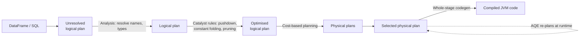

# 7. Spark SQL & performance tuning

!!! abstract "Learning objectives"
    - Use window functions, complex types and higher-order functions for advanced analytics.
    - Explain how the Catalyst optimiser and Adaptive Query Execution (AQE) transform queries.
    - Choose join strategies (broadcast hash, sort-merge, shuffle hash) and force them when needed.
    - Diagnose and fix data skew, spills and small-file problems using the Spark UI.
    - Work with lakehouse tables (Delta Lake) from Spark.

## 7.1 Window functions

A window function computes a value for each row using a group of related rows, **without collapsing them** (unlike `groupBy`).

```python
from pyspark.sql import Window, functions as F

daily = (clean.withColumn("date", F.to_date("tpep_pickup_datetime"))   # clean from Chapter 6
         .groupBy("PULocationID", "date").agg(F.count("*").alias("trips")))

w_zone = Window.partitionBy("PULocationID").orderBy("date")
w_7d   = w_zone.rowsBetween(-6, 0)

features = (daily
    .withColumn("trips_lag1", F.lag("trips", 1).over(w_zone))
    .withColumn("trips_7d_avg", F.avg("trips").over(w_7d))
    .withColumn("growth", (F.col("trips") - F.col("trips_lag1")) / F.col("trips_lag1"))
    .withColumn("rank_today", F.dense_rank().over(
        Window.partitionBy("date").orderBy(F.desc("trips")))))
features.filter("rank_today <= 3").orderBy("date", "rank_today").show()
```

Common window functions: `row_number`, `rank`, `dense_rank`, `lag`, `lead`, `ntile`, `cume_dist`, running `sum`/`avg` with frames. They are essential for time-series features (Chapter 8) and sessionisation.

!!! warning "Windows without `partitionBy`"
    `Window.orderBy("date")` with no partition moves **all** data to one task. Spark warns about this. Always partition when possible.

## 7.2 Complex and nested data

Real big data (JSON logs, API responses, GDELT, GitHub events) is nested. Spark handles `struct`, `array` and `map` types natively.

```python
events = spark.read.json("data/gharchive/2024-01-01-*.json.gz")   # GitHub Archive
events.printSchema()

pushes = (events.filter(F.col("type") == "PushEvent")
          .select("actor.login", "repo.name",
                  F.explode("payload.commits").alias("commit"))
          .select("login", "name", F.col("commit.message").alias("msg")))

# Higher-order functions on arrays — no explode/regroup needed
df = spark.createDataFrame([(1, [3, 8, 1]), (2, [10, 2])], ["id", "xs"])
df.select("id",
          F.transform("xs", lambda x: x * 2).alias("doubled"),
          F.filter("xs", lambda x: x > 2).alias("big"),
          F.aggregate("xs", F.lit(0), lambda acc, x: acc + x).alias("total")).show()
```

## 7.3 How Spark optimises your query



**Adaptive Query Execution (AQE)**, on by default since Spark 3.2, re-optimises *during* execution using real statistics from completed stages:

- **coalesces** small shuffle partitions (so `spark.sql.shuffle.partitions=200` is less harmful);
- **switches** sort-merge joins to broadcast joins when a side turns out small;
- **splits skewed partitions** in joins.

```python
spark.conf.get("spark.sql.adaptive.enabled")                  # 'true'
q.explain(mode="formatted")   # AdaptiveSparkPlan isFinalPlan=false before running, true after
```

## 7.4 Join strategies

| Strategy | When | Cost |
|---|---|---|
| **Broadcast hash join** | One side is small (default threshold 10 MB; raise with care) | Small side copied to every executor; **no shuffle of the big side** |
| **Sort-merge join** | Both sides large | Both sides shuffled and sorted by key |
| **Shuffle hash join** | One side medium, fits in memory per partition | Both shuffled, hash table built |

```python
from pyspark.sql.functions import broadcast

joined = trips.join(broadcast(zones), trips.PULocationID == zones.LocationID)
joined.explain()   # look for BroadcastHashJoin

spark.conf.set("spark.sql.autoBroadcastJoinThreshold", 50 * 1024 * 1024)  # 50 MB
```

Joining 3 billion mobile money records with a 300-row district table should **always** be a broadcast join.

## 7.5 Data skew

Skew means a few keys have far more records than others, so a few tasks run much longer than the rest. Symptoms in the Spark UI → *Stages* → task summary: max duration ≫ median, one task with huge "Shuffle Read Size", and the stage stuck at "199/200".

Examples: one airport zone with 20% of trips; a "null" or "unknown" key; one celebrity account in a social graph.

Fixes, in order of preference:

1. **Let AQE handle it** (`spark.sql.adaptive.skewJoin.enabled=true`, default on).
2. **Filter or handle bad keys** separately (e.g., nulls).
3. **Broadcast** the smaller side if possible.
4. **Salting**: add a random suffix to the hot key to spread it across tasks.

```python
N = 16  # salt buckets
big_salted = big.withColumn("salt", (F.rand() * N).cast("int"))
small_salted = small.crossJoin(spark.range(N).withColumnRenamed("id", "salt"))
result = big_salted.join(small_salted, ["key", "salt"]).drop("salt")
```

For skewed **aggregations**, use two-stage aggregation: aggregate by `(key, salt)` first, then by `key`.

## 7.6 Memory, spills and the small files problem

Executor memory is divided into execution memory (shuffles, joins, sorts) and storage memory (cache). When execution memory is insufficient, Spark **spills** to disk — visible as "Spill (Memory)" and "Spill (Disk)" in the stage page. Fixes: more partitions (smaller tasks), more executor memory, avoid exploding rows unnecessarily.

**Small files:** reading 100,000 tiny files is slow because of per-file overhead. When writing:

```python
(df.repartition("year", "month")              # one task per partition value → fewer files
   .write.partitionBy("year", "month").mode("overwrite").parquet("out/trips"))

spark.conf.set("spark.sql.files.maxRecordsPerFile", 5_000_000)
```

## 7.7 A tuning checklist

1. Read only what you need: Parquet, column selection, early filters, partition pruning.
2. Avoid Python UDFs; use built-in functions or pandas UDFs.
3. Broadcast small dimension tables.
4. Check partition counts: 2–4 per core, ~100–200 MB each; trust AQE but verify.
5. Cache only DataFrames reused multiple times; unpersist afterwards.
6. Never `collect()` large data; aggregate first.
7. Look at the Spark UI: the longest stage, its skew, its spill, its shuffle size.
8. Change **one** thing at a time and measure.

## 7.8 Lakehouse tables from Spark (Delta Lake)

```python
# Start Spark with Delta (versions must match your Spark release; see delta.io)
spark = (SparkSession.builder.appName("delta")
    .config("spark.jars.packages", "io.delta:delta-spark_2.13:<delta-version>")
    .config("spark.sql.extensions", "io.delta.sql.DeltaSparkSessionExtension")
    .config("spark.sql.catalog.spark_catalog", "org.apache.spark.sql.delta.catalog.DeltaCatalog")
    .getOrCreate())

clean.write.format("delta").mode("overwrite").save("lake/trips")

spark.sql("CREATE TABLE IF NOT EXISTS trips USING DELTA LOCATION 'lake/trips'")
spark.sql("DELETE FROM trips WHERE fare_amount > 1000")           # ACID delete
spark.sql("DESCRIBE HISTORY trips").show(truncate=False)           # audit log
spark.read.format("delta").option("versionAsOf", 0).load("lake/trips").count()  # time travel
spark.sql("OPTIMIZE trips ZORDER BY (PULocationID)")               # compaction + clustering
```

On Databricks, Delta is the default table format and needs no configuration.

## Lab 7 — Wikipedia pageviews at scale

Wikimedia publishes hourly pageview counts for every page in every language: [dumps.wikimedia.org/other/pageviews](https://dumps.wikimedia.org/other/pageviews/). Each line is `domain_code page_title count_views total_response_size`.

1. Download 24 hourly files for one day (~1 GB compressed). Read them with Spark using an explicit schema (space-separated).
2. Add the hour from the file name (`F.input_file_name()` and `regexp_extract`).
3. Find the top 20 pages of the day on Kinyarwanda (`rw`), Swahili (`sw`), French (`fr`) and English (`en`) Wikipedia.
4. For English Wikipedia, use window functions to find the pages with the largest hour-on-hour spike. Can you identify what news caused them?
5. Join with a small table of language codes → language names (create it yourself) using a broadcast join. Verify in `explain()`.
6. Find the stage with the longest task in the Spark UI. Is there skew? Which key?
7. Write the cleaned data as Parquet partitioned by `hour` and compare size with the raw files.

## Check yourself

1. What is the difference between `rank` and `dense_rank`?
2. AQE converted your sort-merge join into a broadcast join. What did it observe?
3. Explain salting with a diagram. What does it cost?

## Further reading

- Armbrust et al. (2015). *Spark SQL: Relational Data Processing in Spark*. SIGMOD.
- Spark docs: *Performance Tuning* and *Adaptive Query Execution*.
- Delta Lake documentation: [docs.delta.io](https://docs.delta.io/)
