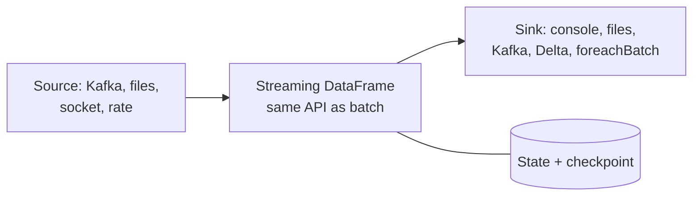

# 9. Streaming analytics

!!! abstract "Learning objectives"
    - Distinguish batch, micro-batch and continuous processing.
    - Explain event time versus processing time, windows and watermarks.
    - Describe the role of a message broker such as Apache Kafka.
    - Build Spark Structured Streaming jobs with aggregations, windows and sinks.
    - Use streaming algorithms (sketches, reservoir sampling) for bounded-memory analytics.

## 9.1 Why streaming?

Some data loses value quickly. Fraud on a mobile money transfer must be stopped before the money moves; a sensor reporting that a water tank is empty matters now, not tomorrow. **Streaming** systems process unbounded data continuously, producing results with low latency.

| | Batch | Streaming |
|---|---|---|
| Input | Bounded (a file, a table) | Unbounded (events keep arriving) |
| Latency | Minutes–hours | Milliseconds–seconds |
| Typical question | "Total sales last month" | "Alert if > 5 failed PINs in 2 minutes" |
| Tools | Spark, Dask, DuckDB | Kafka, Spark Structured Streaming, Apache Flink |

## 9.2 Core concepts

### Event time vs processing time

- **Event time:** when the event happened (the timestamp inside the record).
- **Processing time:** when the system sees it.

On African mobile networks, a phone may buffer transactions offline and upload them an hour later. Analyses must use event time, and must tolerate **late** and **out-of-order** data.

### Windows

```mermaid
gantt
    dateFormat HH:mm
    axisFormat %H:%M
    section Tumbling 10 min
    W1 :00:00, 10m
    W2 :00:10, 10m
    W3 :00:20, 10m
    section Sliding 10 min every 5
    S1 :00:00, 10m
    S2 :00:05, 10m
    S3 :00:10, 10m
```



| Window | Definition | Example |
|---|---|---|
| Tumbling | Fixed size, non-overlapping | Transactions per 5 minutes |
| Sliding | Fixed size, overlapping (slide < size) | 10-minute moving count, updated every minute |
| Session | Gap-based: closes after inactivity | A user's browsing session ends after 30 idle minutes |

### Watermarks

A **watermark** says: "I assume no event older than *max event time seen − delay* will arrive." It lets the engine finalise windows and **discard old state**, bounding memory. Events later than the watermark are dropped.

\[
\text{watermark} = \max(\text{event time seen}) - \text{allowed lateness}
\]

### Delivery guarantees

- *At most once*: may lose events.
- *At least once*: may duplicate events.
- *Exactly once*: each event affects results once. Spark achieves end-to-end exactly-once with replayable sources (Kafka), checkpointing and idempotent/transactional sinks.

## 9.3 Message brokers: Apache Kafka

```mermaid
flowchart LR
    P1[Producers:<br/>apps, sensors, USSD gateway] --> T[(Kafka topic<br/>partition 0 | partition 1 | partition 2)]
    T --> C1[Consumer group A:<br/>fraud detection]
    T --> C2[Consumer group B:<br/>archive to data lake]
```

Kafka is a distributed, durable, append-only **log**. Producers append messages to **topics**, split into **partitions** for parallelism; each message has an **offset**. Consumers read at their own pace and can replay from any offset. This decouples producers from consumers and makes streams replayable — the basis of fault tolerance.

To run Kafka locally for the lab, the `labs/docker-compose.yml` includes an optional single-node Kafka service (KRaft mode). Python clients: `confluent-kafka` or `kafka-python`.

```python
# Producer (pip install confluent-kafka)
from confluent_kafka import Producer
import json, time, random
p = Producer({"bootstrap.servers": "localhost:9092"})
for i in range(1000):
    evt = {"txn_id": i, "district": random.choice(["Gasabo", "Huye", "Musanze", "Rubavu"]),
           "amount": round(random.lognormvariate(8, 1)), "ts": time.time()}
    p.produce("momo-txns", json.dumps(evt).encode())
    time.sleep(0.01)
p.flush()
```

## 9.4 Spark Structured Streaming

Structured Streaming treats a stream as an **unbounded table** to which rows are continuously appended. You write the *same* DataFrame code as for batch; Spark runs it incrementally, by default in **micro-batches**.



### First stream: the built-in `rate` source

```python
from pyspark.sql import SparkSession, functions as F
spark = SparkSession.builder.master("local[*]").appName("stream").getOrCreate()

stream = (spark.readStream.format("rate").option("rowsPerSecond", 50).load())   # (timestamp, value)

counts = (stream
    .withColumn("district", F.element_at(F.array(*[F.lit(d) for d in
                ["Gasabo", "Huye", "Musanze", "Rubavu"]]), (F.col("value") % 4 + 1).cast("int")))
    .withWatermark("timestamp", "30 seconds")
    .groupBy(F.window("timestamp", "10 seconds"), "district")
    .count())

query = (counts.writeStream
         .outputMode("update")          # append | update | complete
         .format("console")
         .option("truncate", False)
         .trigger(processingTime="5 seconds")
         .start())
query.awaitTermination(60); query.stop()
```

### Output modes

| Mode | Emits | Use with |
|---|---|---|
| `append` | Only rows that will never change (finalised windows, after watermark) | Files, Delta |
| `update` | Rows changed since last trigger | Console, dashboards, upsert sinks |
| `complete` | The whole result table every trigger | Small aggregations only |

### Reading from Kafka

```python
raw = (spark.readStream.format("kafka")
       .option("kafka.bootstrap.servers", "localhost:9092")
       .option("subscribe", "momo-txns")
       .option("startingOffsets", "latest")
       .load())
# Requires the package: --packages org.apache.spark:spark-sql-kafka-0-10_2.13:<your-spark-version>

schema = "txn_id long, district string, amount double, ts double"
txns = (raw.select(F.from_json(F.col("value").cast("string"), schema).alias("j"))
           .select("j.*")
           .withColumn("event_time", F.col("ts").cast("timestamp")))

alerts = (txns.withWatermark("event_time", "2 minutes")
          .groupBy(F.window("event_time", "1 minute"), "district")
          .agg(F.count("*").alias("n"), F.sum("amount").alias("volume"))
          .filter(F.col("volume") > 5_000_000))
```

### Writing reliably: checkpoints and `foreachBatch`

```python
query = (txns.writeStream
         .format("parquet")                     # or "delta"
         .option("path", "lake/txns")
         .option("checkpointLocation", "chk/txns")   # offsets + state: enables recovery
         .outputMode("append")
         .start())

def upsert(batch_df, batch_id):
    # arbitrary batch code per micro-batch: write to a database, call a model, etc.
    batch_df.groupBy("district").count().write.mode("append").parquet("lake/district_counts")

q2 = alerts.writeStream.foreachBatch(upsert).option("checkpointLocation", "chk/alerts").start()
```

### Stream–static joins

Enrich events with a reference table (e.g., district → province):

```python
districts = spark.read.csv("data/rwanda_districts.csv", header=True)
enriched = txns.join(F.broadcast(districts), "district", "left")
```

### Monitoring

```python
query.status          # is it active, waiting for data?
query.lastProgress    # input rate, processing rate, batch duration, state size
```

If *processing rate* stays below *input rate*, the job falls behind: add resources, reduce state, or simplify.

## 9.5 Real live data: Wikimedia EventStreams

Wikimedia publishes every edit to every Wikipedia in real time as Server-Sent Events at `https://stream.wikimedia.org/v2/stream/recentchange` — a free, genuine high-velocity stream (dozens of events per second).

A simple bridge writes events to small JSON files that Spark's file source picks up:

```python title="wiki_to_files.py"
import json, time, os, requests

URL = "https://stream.wikimedia.org/v2/stream/recentchange"
os.makedirs("stream_in", exist_ok=True)
headers = {"User-Agent": "AIMS-BDA-course/1.0 (student lab)", "Accept": "text/event-stream"}
buf, t0 = [], time.time()
with requests.get(URL, stream=True, headers=headers, timeout=60) as r:
    for line in r.iter_lines(decode_unicode=True):
        if line and line.startswith("data: "):
            buf.append(line[6:])
        if time.time() - t0 > 5 and buf:            # flush every 5 seconds
            with open(f"stream_in/{int(time.time()*1000)}.json", "w") as f:
                f.write("\n".join(buf))
            buf, t0 = [], time.time()
```

```python
schema = "wiki string, type string, bot boolean, timestamp long, title string, user string"
edits = (spark.readStream.schema(schema).json("stream_in/")
         .withColumn("event_time", F.col("timestamp").cast("timestamp")))

per_wiki = (edits.withWatermark("event_time", "1 minute")
            .groupBy(F.window("event_time", "1 minute"), "wiki", "bot").count())
per_wiki.writeStream.outputMode("update").format("console").start()
```

## 9.6 Streaming algorithms: bounded memory, unbounded data

When you cannot store everything, use **sketches** — compact summaries with provable error bounds.

| Problem | Algorithm | Memory |
|---|---|---|
| Uniform sample of a stream | Reservoir sampling | \(O(k)\) |
| Distinct count | HyperLogLog | ~KB for ~2% error |
| Frequencies of items / heavy hitters | Count-Min Sketch | \(O(\frac{1}{\epsilon}\log\frac{1}{\delta})\) |
| Quantiles | t-digest, KLL | ~KB |
| Membership ("seen before?") | Bloom filter | bits per item |

### Reservoir sampling (Algorithm R)

Keep the first \(k\) items; for the \(i\)-th item (\(i > k\)), replace a random reservoir slot with probability \(k/i\). Every item ends up in the sample with probability \(k/n\).

```python
import random
def reservoir(stream, k, seed=0):
    rng = random.Random(seed); sample = []
    for i, x in enumerate(stream, 1):
        if i <= k: sample.append(x)
        else:
            j = rng.randint(1, i)
            if j <= k: sample[j - 1] = x
    return sample
```

### Count-Min Sketch

```python
import numpy as np, hashlib
class CountMin:
    def __init__(self, width=2000, depth=5):
        self.w, self.d = width, depth
        self.table = np.zeros((depth, width), dtype=np.int64)
    def _h(self, x, i):
        return int(hashlib.blake2b(f"{i}:{x}".encode(), digest_size=8).hexdigest(), 16) % self.w
    def add(self, x, c=1):
        for i in range(self.d): self.table[i, self._h(x, i)] += c
    def estimate(self, x):
        return min(self.table[i, self._h(x, i)] for i in range(self.d))   # never underestimates
```

Spark has built-ins: `F.approx_count_distinct` (HyperLogLog++), `percentile_approx`, `df.stat.countMinSketch`, `df.stat.bloomFilter`.

## Lab 9 — Live Wikipedia edits

1. Run `wiki_to_files.py` in a terminal; run the streaming query in a notebook.
2. Every minute, report edits per wiki, split by bot vs human. Which wikis are most active? Watch `rw.wikipedia.org` and `sw.wikipedia.org`.
3. Add a 10-minute sliding window (sliding every minute) of distinct editors per wiki using `approx_count_distinct`.
4. Write raw events to Parquet with a checkpoint. Kill and restart the query; verify that no data is lost or duplicated.
5. Implement reservoir sampling and a Count-Min Sketch in plain Python over the stream; compare top-10 titles from the sketch with exact counts.

## Check yourself

1. Why is a watermark needed for streaming aggregations in `append` mode?
2. A phone uploads a transaction 3 hours late; your watermark is 1 hour. What happens? Is that acceptable for fraud detection? For monthly reporting?
3. Why can a Count-Min Sketch overestimate but never underestimate?

## Further reading

- Akidau, Chernyak & Lax. *Streaming Systems*. O'Reilly.
- Spark docs: *Structured Streaming Programming Guide*.
- Kreps, J. (2013). *The Log: What every software engineer should know about real-time data's unifying abstraction*.
- Cormode & Muthukrishnan (2005). *An improved data stream summary: the count-min sketch and its applications*.
