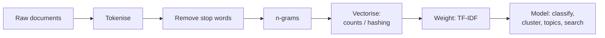

# 11. Text & graph analytics at scale

!!! abstract "Learning objectives"
    - Build scalable text pipelines: tokenisation, TF-IDF, hashing trick, topic models.
    - Find near-duplicate documents with MinHash and Locality-Sensitive Hashing (LSH).
    - Represent large graphs and compute degree, PageRank and connected components in a distributed way.
    - Apply these methods to African-language text and to networks such as mobility or transactions.

## Part A — Text at scale

### 11.1 From text to vectors

Text is the largest unstructured data source: web pages, social media, SMS, call-centre transcripts, parliamentary records. The classic scalable pipeline:



**TF-IDF** weights a term \(t\) in document \(d\) by how frequent it is in \(d\) and how rare across the \(N\) documents:

\[
\text{tfidf}(t,d) = \text{tf}(t,d)\cdot \log\frac{N+1}{\text{df}(t)+1}.
\]

Computing \(\text{df}(t)\) needs a pass over the whole corpus — a word count (Chapter 4).

**The hashing trick.** A vocabulary of millions of words needs a large dictionary shared by all workers. Instead, map each token to `hash(token) mod 2^k` — no dictionary, no extra pass, fixed memory. Collisions are rare enough with \(2^{18}\)–\(2^{20}\) features.

### 11.2 Spark ML text pipeline

```python
from pyspark.ml import Pipeline
from pyspark.ml.feature import RegexTokenizer, StopWordsRemover, HashingTF, IDF, NGram
from pyspark.ml.classification import LogisticRegression
from pyspark.sql import functions as F

reviews = spark.read.json("data/amazon_reviews/*.jsonl.gz")      # e.g. Amazon Reviews 2023
data = (reviews.select("text", "rating")
        .withColumn("label", (F.col("rating") >= 4).cast("double"))
        .filter(F.length("text") > 20))

tok = RegexTokenizer(inputCol="text", outputCol="tokens", pattern=r"\W+", minTokenLength=2)
sw  = StopWordsRemover(inputCol="tokens", outputCol="words")
tf  = HashingTF(inputCol="words", outputCol="tf", numFeatures=2**18)
idf = IDF(inputCol="tf", outputCol="features", minDocFreq=5)
clf = LogisticRegression(maxIter=30, regParam=0.01)

model = Pipeline(stages=[tok, sw, tf, idf, clf]).fit(data)
```

`StopWordsRemover` ships lists for several languages (`StopWordsRemover.loadDefaultStopWords("french")`). For **Kinyarwanda** and many other African languages there is no built-in list: build one from corpus frequency (top-N most frequent tokens, reviewed by a speaker) — a good exercise in itself.

### 11.3 Topic modelling with LDA

```python
from pyspark.ml.feature import CountVectorizer
from pyspark.ml.clustering import LDA

cv = CountVectorizer(inputCol="words", outputCol="counts", vocabSize=20000, minDF=10)
cv_model = cv.fit(words_df); counts = cv_model.transform(words_df)
lda = LDA(k=15, maxIter=20, featuresCol="counts").fit(counts)

vocab = cv_model.vocabulary
for row in lda.describeTopics(8).collect():
    print(row.topic, [vocab[i] for i in row.termIndices])
```

### 11.4 Near-duplicate detection: MinHash and LSH

Web crawls and news feeds contain many near-copies. Comparing all pairs of \(n\) documents is \(O(n^2)\) — impossible for \(10^8\) documents.

1. Represent each document as a set of **shingles** (e.g., word 3-grams).
2. **Jaccard similarity** \(J(A,B) = |A\cap B| / |A\cup B|\).
3. **MinHash:** for a random hash function \(h\), \(\Pr[\min h(A) = \min h(B)] = J(A,B)\). A signature of \(k\) min-hashes estimates \(J\).
4. **LSH:** split signatures into bands; documents sharing any identical band become candidate pairs. Only candidates are compared.

```python
from pyspark.ml.feature import MinHashLSH, NGram, HashingTF

ng = NGram(n=3, inputCol="words", outputCol="shingles")
htf = HashingTF(inputCol="shingles", outputCol="sh_vec", numFeatures=2**20, binary=True)
docs = htf.transform(ng.transform(words_df)).filter(F.size("shingles") > 0)

mh = MinHashLSH(inputCol="sh_vec", outputCol="hashes", numHashTables=5).fit(docs)
pairs = mh.approxSimilarityJoin(docs, docs, threshold=0.3, distCol="jaccard_dist") \
          .filter("datasetA.id < datasetB.id")
```

### 11.5 Beyond bag-of-words

Transformer embeddings (multilingual models such as AfroXLMR, Serengeti, or general multilingual sentence encoders) capture meaning far better. At scale, the pattern is the same as model scoring in Chapter 8: broadcast or load the model once per executor and embed in batches with a pandas UDF; store vectors in Parquet; search with an approximate nearest-neighbour index (FAISS, or the vector functions in DuckDB/Lance). GPU access usually becomes the constraint, not data size.

## Part B — Graphs at scale

### 11.6 Graph basics

A graph \(G = (V, E)\): people and calls, accounts and transfers, web pages and links, road intersections and segments. Big graphs have billions of edges and **power-law degree distributions**: a few hubs with enormous degree (skew, again!).

Representations for distributed processing:

- **Edge list** table `(src, dst, weight)` — the natural format for Spark and DuckDB.
- **Adjacency lists** `(node, [neighbours])` — good for iterative message passing.

NetworkX is excellent up to ~1 million edges; beyond that, use distributed or optimised engines (GraphFrames on Spark, or single-node libraries such as igraph and graph-tool).

### 11.7 Degree and triangles with plain DataFrames

```python
edges = spark.read.parquet("data/edges.parquet")    # src, dst
deg = (edges.select(F.col("src").alias("node")).union(edges.select(F.col("dst").alias("node")))
       .groupBy("node").count().withColumnRenamed("count", "degree"))
deg.orderBy(F.desc("degree")).show(10)

# Degree distribution on log–log scale reveals power laws
dist = deg.groupBy("degree").count().toPandas()
```

### 11.8 PageRank as iterated MapReduce

PageRank models a random surfer who follows links with probability \(d\) (≈0.85) and teleports otherwise:

\[
PR(v) = \frac{1-d}{N} + d \sum_{u \to v} \frac{PR(u)}{\text{out}(u)}.
\]

Each iteration is one map (each node sends \(PR(u)/\text{out}(u)\) to its neighbours) and one reduce (sum incoming contributions) — a join plus a groupBy.

```python
from pyspark.sql import functions as F
N = edges.select("src").union(edges.select("dst")).distinct().count()
out_deg = edges.groupBy("src").agg(F.count("*").alias("out"))
links = edges.join(out_deg, "src").cache()

ranks = links.select(F.col("src").alias("node")).union(links.select(F.col("dst").alias("node"))) \
             .distinct().withColumn("pr", F.lit(1.0 / N))
d = 0.85
for i in range(15):
    contrib = (links.join(ranks.withColumnRenamed("node", "src"), "src")
               .select(F.col("dst").alias("node"), (F.col("pr") / F.col("out")).alias("c")))
    ranks = (contrib.groupBy("node").agg(F.sum("c").alias("s"))
             .select("node", ((1 - d) / N + d * F.col("s")).alias("pr")))
    if i % 5 == 4:
        ranks = ranks.localCheckpoint()     # truncate lineage growth in long loops
ranks.orderBy(F.desc("pr")).show(10)
```

(Dangling nodes with no out-links leak rank in this simple version; production implementations redistribute it.)

### 11.9 GraphFrames

GraphFrames provides graph algorithms on Spark DataFrames: PageRank, connected components, label propagation (communities), shortest paths, triangle counts and **motif finding**.

```python
# pyspark --packages io.graphframes:graphframes-spark4_2.13:<version>  (check graphframes.io for current coordinates)
from graphframes import GraphFrame

v = deg.withColumnRenamed("node", "id")
e = edges
g = GraphFrame(v, e)

pr = g.pageRank(resetProbability=0.15, maxIter=10)
pr.vertices.orderBy(F.desc("pagerank")).show(10)

spark.sparkContext.setCheckpointDir("chk/graph")
cc = g.connectedComponents()
cc.groupBy("component").count().orderBy(F.desc("count")).show()

# Motif: find reciprocal transfers a → b → a (possible money cycling)
g.find("(a)-[e1]->(b); (b)-[e2]->(a)").filter("a.id < b.id").show()
```

### 11.10 Datasets for graph labs

- **Wikipedia link graph** (pagelinks dumps) — PageRank of articles in Kinyarwanda/Swahili Wikipedia.
- **SNAP collection** (Stanford Large Network Dataset Collection) — social, web, road and citation networks from thousands to billions of edges.
- **OpenStreetMap roads** for Rwanda (Geofabrik extract) → road graph; shortest paths to health facilities.
- **GitHub Archive** events → developer–repository bipartite graph.
- **Synthetic mobile money graphs** (PaySim-style simulators) for fraud motif detection without privacy risk.

## Lab 11 — Kinyarwanda Wikipedia: text and links

1. Download the `rwwiki` articles dump and page links (from dumps.wikimedia.org/rwwiki). Parse articles into `(id, title, text)` (the `mwxml` or `wikiextractor` tools help).
2. Build a frequency-based Kinyarwanda stop-word list (top 100 tokens) and justify edits to it.
3. Fit TF-IDF and LDA (k = 10). Label the topics.
4. Detect near-duplicate or template-generated articles with MinHash LSH.
5. Build the article link graph; compute PageRank with your own loop and with GraphFrames; compare the top 20.
6. Repeat on Swahili (`swwiki`) and compare the most central articles between the two languages.

## Check yourself

1. Why does the hashing trick avoid a second pass over the data? What is the cost?
2. Why does MinHash estimate Jaccard similarity?
3. What causes skew in graph processing, and which PageRank step suffers?

## Further reading

- *Mining of Massive Datasets*, Chapters 3 (similarity, LSH), 5 (link analysis), 10 (social graphs).
- Page, Brin, Motwani & Winograd (1999). *The PageRank Citation Ranking*.
- Masakhane — community research on African-language NLP: [masakhane.io](https://www.masakhane.io/)
- SNAP datasets: [snap.stanford.edu/data](https://snap.stanford.edu/data/)
