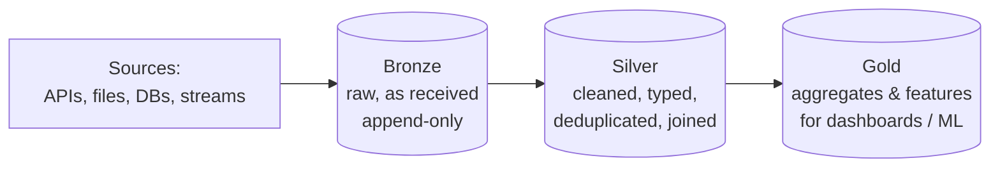

# 12. Pipelines, orchestration & the cloud

!!! abstract "Learning objectives"
    - Design ETL/ELT pipelines with layered (medallion) architecture.
    - Write idempotent, testable pipeline steps with data quality checks.
    - Explain workflow orchestration (DAGs, scheduling, retries, backfills) with Apache Airflow.
    - Package environments with Docker for reproducibility.
    - Compare cloud big data services and estimate costs.

## 12.1 From notebook to pipeline

A notebook answers a question once. A **pipeline** answers it every day, reliably, without you. Properties of a good pipeline:

| Property | Meaning | How |
|---|---|---|
| Idempotent | Re-running gives the same result, no duplicates | Overwrite partitions by date; `MERGE` instead of blind `append` |
| Incremental | Processes only new data | Partition by ingestion date; track watermarks/offsets |
| Observable | You know when and why it fails | Logging, metrics, alerts |
| Tested | Code and data are checked | Unit tests on functions; data quality assertions |
| Reproducible | Same inputs + code → same outputs | Version control, pinned environments, containers |

## 12.2 ETL vs ELT and the medallion architecture

- **ETL** (Extract–Transform–Load): transform before loading into a warehouse. Traditional.
- **ELT**: load raw data first into cheap storage, transform inside the lake/warehouse engine. Modern default, because storage is cheap and raw data can be reprocessed when logic changes.



```python title="pipeline/steps.py"
from pyspark.sql import DataFrame, functions as F

def bronze_to_silver(raw: DataFrame) -> DataFrame:
    return (raw
        .withColumn("pickup_ts", F.to_timestamp("tpep_pickup_datetime"))
        .withColumn("dropoff_ts", F.to_timestamp("tpep_dropoff_datetime"))
        .filter(F.col("fare_amount").between(0, 1000))
        .filter(F.col("dropoff_ts") > F.col("pickup_ts"))
        .dropDuplicates(["VendorID", "pickup_ts", "dropoff_ts", "PULocationID", "DOLocationID"])
        .withColumn("ds", F.to_date("pickup_ts")))

def silver_to_gold(silver: DataFrame) -> DataFrame:
    return (silver.groupBy("ds", "PULocationID")
            .agg(F.count("*").alias("trips"), F.sum("total_amount").alias("revenue")))
```

Idempotent writes of one day's partition:

```python
spark.conf.set("spark.sql.sources.partitionOverwriteMode", "dynamic")
(silver_to_gold(silver.filter(F.col("ds") == run_date))
   .write.mode("overwrite").partitionBy("ds").parquet("lake/gold/zone_daily"))
```

## 12.3 Testing code and data

### Unit tests with a small Spark session

```python title="tests/test_steps.py"
import pytest
from pyspark.sql import SparkSession
from pipeline.steps import bronze_to_silver

@pytest.fixture(scope="session")
def spark():
    return SparkSession.builder.master("local[1]").appName("tests").getOrCreate()

def test_negative_fares_removed(spark):
    raw = spark.createDataFrame(
        [(1, "2024-01-01 10:00:00", "2024-01-01 10:10:00", -5.0, 1, 2)],
        ["VendorID", "tpep_pickup_datetime", "tpep_dropoff_datetime", "fare_amount",
         "PULocationID", "DOLocationID"])
    assert bronze_to_silver(raw).count() == 0
```

### Data quality checks

Write assertions about the data itself: row counts within expected ranges, no nulls in keys, valid ranges, referential integrity, freshness.

```python
def check(df, run_date):
    problems = []
    n = df.count()
    if n == 0: problems.append("no rows")
    nulls = df.filter(F.col("PULocationID").isNull()).count()
    if nulls / max(n, 1) > 0.01: problems.append(f"{nulls} null zones")
    if df.filter(F.col("trips") < 0).count(): problems.append("negative counts")
    if problems:
        raise ValueError(f"DQ failed for {run_date}: {problems}")
```

Libraries such as **Great Expectations**, **Soda** and **pandera** (pandas/Polars/PySpark schemas) formalise this.

## 12.4 Orchestration with Apache Airflow

An orchestrator runs pipeline steps in the right order, on a schedule, with retries, alerts and **backfills** (re-running past dates). In Airflow, a workflow is a **DAG** of tasks defined in Python.

```python title="dags/taxi_daily.py"
from datetime import datetime, timedelta
from airflow.sdk import dag, task        # Airflow 3 TaskFlow API (Airflow 2: from airflow.decorators import dag, task)

@dag(schedule="@daily", start_date=datetime(2024, 1, 1), catchup=False,
     default_args={"retries": 2, "retry_delay": timedelta(minutes=10)}, tags=["aims-bda"])
def taxi_daily():

    @task
    def ingest(ds=None):
        # download / land raw files for date ds into bronze
        ...

    @task
    def to_silver(ds=None):
        # spark-submit pipeline/jobs/silver.py --date ds
        ...

    @task
    def to_gold(ds=None): ...

    @task
    def quality(ds=None): ...

    ingest() >> to_silver() >> to_gold() >> quality()

taxi_daily()
```

Alternatives worth knowing: **Prefect** and **Dagster** (Python-native, asset-oriented), **dbt** (SQL transformations with tests and lineage inside a warehouse or DuckDB), and cloud-managed schedulers (Databricks Workflows, AWS Step Functions, Google Cloud Composer).

## 12.5 Reproducibility with Docker

A container packages code, libraries, Java and system dependencies into one image that runs identically anywhere.

```dockerfile title="Dockerfile"
FROM python:3.12-slim
RUN apt-get update && apt-get install -y --no-install-recommends openjdk-17-jre-headless \
    && rm -rf /var/lib/apt/lists/*
WORKDIR /app
COPY requirements.txt .
RUN pip install --no-cache-dir -r requirements.txt
COPY pipeline/ pipeline/
CMD ["python", "-m", "pipeline.run", "--date", "today"]
```

```bash
docker build -t taxi-pipeline .
docker run --rm -v "$PWD/lake:/app/lake" taxi-pipeline
```

## 12.6 Big data in the cloud

| Need | AWS | Google Cloud | Azure | Open / vendor-neutral |
|---|---|---|---|---|
| Object storage | S3 | Cloud Storage | Blob / ADLS Gen2 | MinIO |
| Managed Spark | EMR, Glue | Dataproc | HDInsight / Synapse / Fabric | Databricks (all clouds) |
| Serverless SQL warehouse | Athena, Redshift Serverless | BigQuery | Synapse / Fabric | Snowflake, MotherDuck |
| Streaming | Kinesis, MSK (Kafka) | Pub/Sub, Dataflow | Event Hubs | Confluent, Redpanda |
| Orchestration | MWAA (Airflow), Step Functions | Cloud Composer | Data Factory | Airflow, Dagster, Prefect |

### Free and academic options for students

- **Google BigQuery sandbox** — free tier with monthly query allowance; hosts many public datasets (GDELT, GitHub, Wikipedia, NOAA).
- **Databricks Free Edition** — Spark notebooks and SQL with serverless compute.
- **Google Colab** — free notebooks; good for Polars, DuckDB, Dask and local-mode Spark.
- **Kaggle Notebooks** — free CPU/GPU with many datasets attached.
- **Cloud credits for education** — AWS, Google Cloud and Azure run academic credit programmes; availability changes, so check each provider.

### Thinking about cost

Cloud cost ≈ compute time × machine price + storage × months + data scanned (for serverless SQL) + **egress** (data leaving the cloud). Habits that save money: store Parquet not CSV (less to scan), partition and filter (scan less), auto-terminate clusters, use spot/preemptible instances for fault-tolerant Spark jobs, and keep compute in the same region as the data. Africa-based regions (e.g., AWS Cape Town `af-south-1`, Azure South Africa, Google Johannesburg) reduce latency and may matter for data residency requirements (Chapter 13).

## Lab 12 — A mini production pipeline

Build a daily pipeline for NYC taxi data (simulate days by processing one date at a time) or for a dataset of your choice:

1. Bronze: land raw monthly files untouched.
2. Silver: clean and deduplicate; write partitioned by `ds`.
3. Gold: daily zone aggregates.
4. Add three unit tests (pytest) and three data quality checks.
5. Make the gold step idempotent: run the same date twice and prove the row count does not change.
6. **Optional:** orchestrate with Airflow (`pip install apache-airflow`, `airflow standalone`) or Prefect, and run a backfill for one week.
7. Package the pipeline in a Docker image and document how to run it.

## Check yourself

1. Why is `mode("append")` dangerous in a daily job that may be retried?
2. What is a backfill, and why does it require idempotency?
3. Estimate whether it is cheaper to keep a cluster running 24/7 or to start it for 2 hours per day.

## Further reading

- Reis & Housley. *Fundamentals of Data Engineering*. O'Reilly.
- Apache Airflow docs: [airflow.apache.org/docs](https://airflow.apache.org/docs/)
- Google SRE book, chapter on data processing pipelines (free online).
