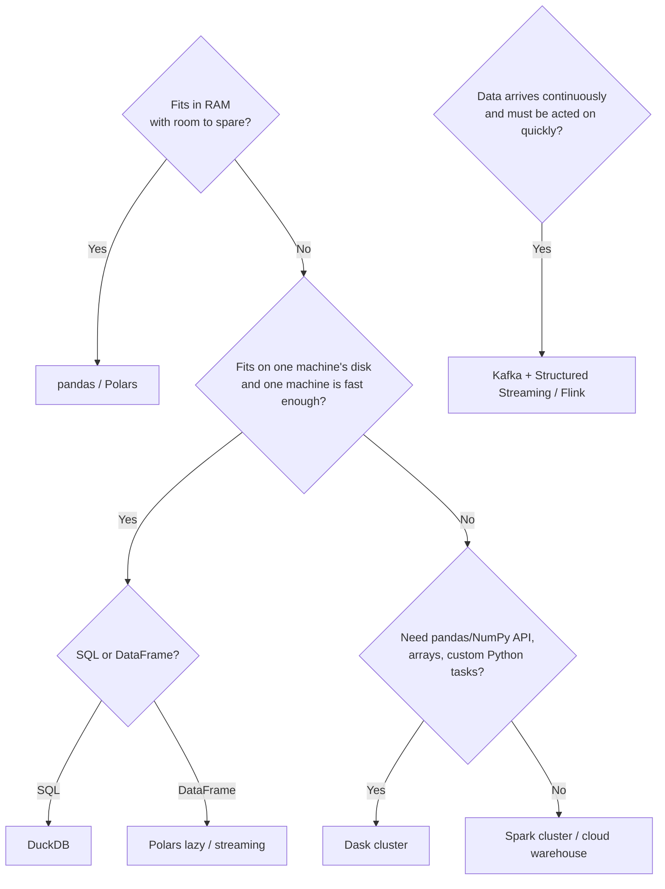

# Cheat sheets

The same operations across tools. All examples compute: filter positive fares, add tip percentage, group by pickup zone, average.

## Read, filter, derive, aggregate

=== "pandas"
    ```python
    df = pd.read_parquet("trips.parquet", columns=["PULocationID", "fare_amount", "tip_amount"])
    out = (df[df.fare_amount > 0]
           .assign(tip_pct=lambda d: 100 * d.tip_amount / d.fare_amount)
           .groupby("PULocationID", as_index=False)["tip_pct"].mean())
    ```

=== "Polars"
    ```python
    out = (pl.scan_parquet("trips.parquet")
           .filter(pl.col("fare_amount") > 0)
           .with_columns((100 * pl.col("tip_amount") / pl.col("fare_amount")).alias("tip_pct"))
           .group_by("PULocationID").agg(pl.col("tip_pct").mean())
           .collect())
    ```

=== "DuckDB"
    ```python
    out = duckdb.sql("""
        SELECT PULocationID, avg(100 * tip_amount / fare_amount) AS tip_pct
        FROM 'trips.parquet' WHERE fare_amount > 0 GROUP BY 1
    """).df()
    ```

=== "Dask"
    ```python
    ddf = dd.read_parquet("trips.parquet", columns=["PULocationID", "fare_amount", "tip_amount"])
    ddf = ddf[ddf.fare_amount > 0]
    ddf["tip_pct"] = 100 * ddf.tip_amount / ddf.fare_amount
    out = ddf.groupby("PULocationID").tip_pct.mean().compute()
    ```

=== "PySpark"
    ```python
    out = (spark.read.parquet("trips.parquet")
           .filter(F.col("fare_amount") > 0)
           .withColumn("tip_pct", 100 * F.col("tip_amount") / F.col("fare_amount"))
           .groupBy("PULocationID").agg(F.avg("tip_pct").alias("tip_pct")))
    ```

## Common PySpark functions

| Task | Code |
|---|---|
| Column reference | `F.col("x")`, `df.x`, `df["x"]` |
| Literal | `F.lit(5)` |
| Conditional | `F.when(cond, a).when(cond2, b).otherwise(c)` |
| Null handling | `F.coalesce(a, b)`, `df.fillna({...})`, `df.dropna(subset=[...])` |
| Strings | `F.lower`, `F.trim`, `F.regexp_extract(col, pattern, 1)`, `F.split`, `F.concat_ws` |
| Dates | `F.to_date`, `F.to_timestamp`, `F.year`, `F.hour`, `F.date_trunc("week", ts)`, `F.datediff` |
| Arrays | `F.explode`, `F.size`, `F.array_contains`, `F.transform`, `F.filter` |
| JSON | `F.from_json(col, schema)`, `F.to_json`, `F.get_json_object` |
| Approximate stats | `F.approx_count_distinct`, `F.percentile_approx` |
| Windows | `Window.partitionBy(...).orderBy(...)`, `F.lag`, `F.row_number`, `.rowsBetween(-6, 0)` |
| Broadcast | `df.join(F.broadcast(small), "key")` |
| Plan | `df.explain("formatted")` |

## Spark configuration you will actually change

| Setting | Typical value | Why |
|---|---|---|
| `spark.driver.memory` | `4g`–`8g` locally | Local mode runs everything in the driver |
| `spark.sql.shuffle.partitions` | `16`–`64` locally; ~data size / 128 MB on clusters | Default 200 is often too many for small data |
| `spark.sql.adaptive.enabled` | `true` (default) | AQE coalesces partitions, handles skew |
| `spark.sql.autoBroadcastJoinThreshold` | `10MB`–`100MB` | Broadcast small tables |
| `spark.sql.execution.arrow.pyspark.enabled` | `true` | Fast `toPandas()` and pandas UDFs |
| `spark.jars.packages` | Maven coordinates | Add Delta, Kafka, Sedona, GraphFrames |

## Which tool when?



## Spark UI: where to look

| Tab | Question it answers |
|---|---|
| Jobs | Which action is slow? |
| Stages | Which stage? Is there skew (max ≫ median task time)? Spill? Shuffle size? |
| Storage | What is cached, how much memory? |
| Environment | Which configuration is really active? |
| Executors | GC time, memory use, failed tasks |
| SQL / DataFrame | Plan with row counts per operator |
